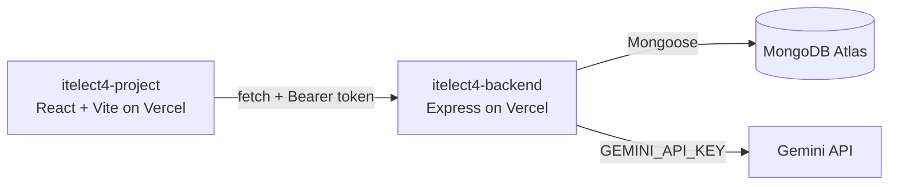

# ITELECT4 Backend - Peer Tutoring API

[](https://github.com/jeclique444/itelect4-backend/actions/workflows/ci.yml)

A robust REST API built with Express and TypeScript, powering a Peer Tutoring Platform. It handles user authentication, tutoring session management, and integrates with Google's Gemini AI to provide automated reviews for session plans.

## 🔗 Live URLs

*   **Live Backend API:** [https://itelect4-backend-neon.vercel.app](https://itelect4-backend-neon.vercel.app)
*   **Live Frontend App:** [https://itelect4-project-two.vercel.app](https://itelect4-project-two.vercel.app)
*   **Frontend Repository:** [https://github.com/jeclique444/itelect4-project](https://github.com/jeclique444/itelect4-project)

## Architecture



## Features

- **Authentication:** Secure user registration and login using JWT (JSON Web Tokens) and bcrypt password hashing.
- **Session Management:** Full CRUD operations for tutoring sessions. Routes are strictly protected, ensuring users can only manage their own sessions.
- **AI Integration:** A specialized `POST /api/ai` endpoint that uses Google's `@google/genai` SDK. It validates user input, securely calls the Gemini API, and returns a strictly typed JSON review (Summary, Strengths, Improvements, Readiness).
- **Rate Limiting:** Protects the AI endpoint from abuse by limiting requests per user.
- **Automated Testing:** Comprehensive integration tests using Vitest and Supertest to ensure API security and validation work correctly.

## Tech Stack

*   **Runtime:** Node.js, Express
*   **Language:** TypeScript
*   **Database:** MongoDB Atlas, Mongoose
*   **Security:** JWT, bcryptjs, CORS, express-rate-limit
*   **AI:** `@google/genai` (Gemini API)
*   **Testing & CI:** Vitest, Supertest, GitHub Actions

## Local Setup

1.  **Clone the repository:**
    ```bash
    git clone https://github.com/jeclique444/itelect4-backend.git
    cd itelect4-backend
    ```

2.  **Install dependencies:**
    ```bash
    npm install
    ```

3.  **Environment Variables:**
    Copy `.env.example` to `.env` and fill in the necessary values:
    ```env
    PORT=4000
    MONGODB_URI=your_mongodb_connection_string
    JWT_SECRET=your_super_secret_jwt_key
    CORS_ORIGIN=http://localhost:5173
    GEMINI_API_KEY=your_google_gemini_api_key
    ```

4.  **Run the development server:**
    ```bash
    npm run dev
    ```
    The API will run on `http://localhost:4000`.

## Testing

This project uses **Vitest** and **Supertest** to run backend integration tests without needing a live database or Gemini API key.

```bash
# Run the test suite
npm test

# Type-check the codebase
npm run typecheck
```

*Note: The CI workflow in `.github/workflows/ci.yml` automatically runs these tests on every push to the repository.*

## API Endpoints

| Method | Endpoint | Auth Required | Description |
| :--- | :--- | :--- | :--- |
| **GET** | `/api/health` | No | Health check for database connection |
| **POST** | `/api/auth/register` | No | Register a new user |
| **POST** | `/api/auth/login` | No | Login and receive a JWT token |
| **GET** | `/api/sessions` | **Yes** | Retrieve all sessions for the logged-in user |
| **GET** | `/api/sessions/:id` | **Yes** | Retrieve a specific session by ID |
| **POST** | `/api/sessions` | **Yes** | Create a new tutoring session |
| **PATCH** | `/api/sessions/:id` | **Yes** | Update an existing session |
| **DELETE** | `/api/sessions/:id` | **Yes** | Delete a session |
| **POST** | `/api/ai` | **Yes** | Get an AI-generated review of a session plan |

## AI-Use Disclosure

This backend integrates the **Google Gemini API** to generate session reviews. The integration was designed and implemented by the student. The system uses a dedicated System Prompt and structured JSON schema to ensure the AI's output is predictable and strictly formatted. AI tools (like ChatGPT/Gemini) were also used as coding assistants for debugging and boilerplate generation.

## Author

**Jeric Lique** - ITELECT4 Student